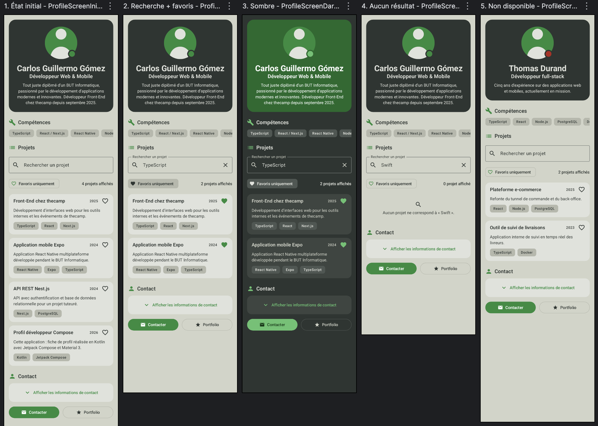

# Profil développeur interactif

Dépôt : https://github.com/CJG2/profil-developper-carlos-guillermogomez-3

Carlos Guillermo Gomez - ESGI 4 IW - Aix en provence

Troisième version de l'application " Profil développeur"

Les versions précédentes restent dans leurs propres dépôts :
[version 1](https://github.com/CJG2/profil-developper-carlos-guillermogomez) ·
[version 2 (amélioration UI)](https://github.com/CJG2/profil-developper-carlos-guillermogomez-2)

## 2. Description de l'application

L'application présente le profil d'un développeur (avatar, nom, rôle, description, compétences, projets, contact) sous forme de petit portfolio interactif. L'utilisateur peut maintenant :

- **rechercher un projet** par son titre, une technologie, sa description ou son année ; la liste se met à jour à chaque lettre tapée ;
- **ajouter ou retirer un projet des favoris** avec l'icône cœur de chaque carte (cœur plein = favori) ;
- **afficher uniquement les projets favoris** avec le bouton « Favoris uniquement » ;
- voir le **nombre de projets affichés** (« 4 projets affichés », « 1 projet affiché »), qui suit la recherche et le filtre ;
- **afficher ou masquer les informations de contact**.

Quand aucun projet ne correspond, un message l'indique à la place de la liste.
Les données restent locales, écrites en Kotlin dans `data/ProfileData.kt`. Chaque projet a un identifiant `id`.

## 3. États gérés par l'application

L'état principal de l'écran est regroupé dans la classe `ProfileUiState` et géré par `ProfileViewModel` :

| État | Type | Rôle |
|---|---|---|
| `profile` | `Profile` | Les données du développeur, dont la liste complète des projets |
| `searchQuery` | `String` | Le texte de recherche |
| `showOnlyFavorites` | `Boolean` | Le filtre « favoris uniquement » activé ou non |
| `favoriteProjectIds` | `Set<Int>` | Les identifiants des projets favoris (un `Set` évite les doublons) |
| `visibleProjects` | `List<Project>` | La liste réellement affichée, après la recherche et le filtre |

Le nombre de projets affichés n'est pas stocké : il est calculé à partir de `visibleProjects.size`, il ne peut donc jamais être faux.

Un état local reste en dehors du ViewModel : l'ouverture de la zone de contact (voir la partie suivante).

## 4. État local

> Quel état avez-vous conservé directement dans un composable et pourquoi ?

J'ai gardé dans le composable `ContactSection` l'état qui indique si les informations de contact sont affichées ou masquées :

```kotlin
var isExpanded by rememberSaveable { mutableStateOf(initiallyExpanded) }
```

Cet état ne concerne que l'affichage de cette zone : il ne change ni les projets, ni la recherche, ni les favoris, et aucun autre composable ni le ViewModel n'en a besoin. Le mettre dans le ViewModel ajouterait du code sans rien apporter.
J'ai utilisé `rememberSaveable` plutôt que `remember` pour que la zone reste ouverte si l'utilisateur tourne son téléphone.

## 5. State Hoisting

> Pourquoi votre composable d'écran principal peut-il être considéré comme stateless ?

`ProfileScreen` ne stocke pas l'état principal : il ne contient aucun `remember` pour la recherche, le filtre ou les favoris, et il ne connaît pas le ViewModel.
Il reçoit tout ce qu'il affiche en **paramètres** (`searchQuery`, `showOnlyFavorites`, `favoriteProjectIds`, `visibleProjects`, `profile`) et signale les actions de l'utilisateur par des **callbacks** (`onSearchQueryChange`, `onToggleFavoriteFilter`, `onFavoriteClick`).
L'état est donc « remonté » (hoisted) vers le ViewModel. C'est ce qui permet aux previews d'afficher n'importe quel état simplement en passant d'autres valeurs.

Les petits composants suivent le même principe : `ProjectCard` reçoit `isFavorite` et `onFavoriteClick`, `ProjectSearchField` reçoit `query` et `onQueryChange`, `ProjectFilterBar` reçoit `showOnlyFavorites` et `onToggleFavoriteFilter`.

## 6. ViewModel

> Quel est le rôle de votre ViewModel dans cette application ?

`ProfileViewModel` gère l'état principal de l'écran et les actions de l'utilisateur :

- `onSearchQueryChange(query)` met à jour le texte de recherche ;
- `onToggleFavoriteFilter()` active ou désactive le filtre « favoris uniquement » ;
- `onFavoriteClick(projectId)` ajoute le projet aux favoris, ou l'en retire s'il y est déjà.

Après chaque action, il recalcule la liste affichée avec la fonction `filterProjects()`. Toutes les actions passent par une seule fonction privée, `updateState`, donc la liste est toujours cohérente : par exemple, retirer un favori pendant que le filtre « favoris uniquement » est actif fait disparaître le projet immédiatement.
Le ViewModel ne dépend d'aucun composant Compose, et il survit à la rotation de l'écran : la recherche et les favoris ne sont pas perdus.

## 7. StateFlow

> Comment l'interface est-elle informée lorsqu'un état change ?

Le ViewModel garde l'état dans un `MutableStateFlow` **privé** : lui seul peut le modifier. Il expose une version **publique en lecture seule**, `uiState: StateFlow<ProfileUiState>`.

Quand l'utilisateur fait une action (taper une lettre, toucher un cœur…), l'écran appelle un callback, donc une fonction du ViewModel. Celle-ci crée un nouvel état avec `copy()` et le publie dans le `StateFlow` avec `update { }`.
Dans `ProfileContainer`, `viewModel.uiState.collectAsState()` observe ce `StateFlow` : dès qu'un nouvel état est publié, Compose relit la valeur et recompose `ProfileScreen` avec les nouvelles données. L'écran n'a jamais besoin de demander lui-même si quelque chose a changé.

```
ViewModel ──publie un état──▶ ProfileContainer ──transmet les valeurs──▶ ProfileScreen
    ▲                                                                       │
    └──────────────────────── événement (callback) ─────────────────────────┘
```

## 8. Organisation du code

```
com.example.profildeveloppeurcarlos/
├── MainActivity.kt              thème + Scaffold + ProfileContainer
├── model/                       Profile, Project (avec id)
├── data/ProfileData.kt          données locales
├── ui/profile/
│   ├── ProfileUiState.kt        état de l'écran + filterProjects()
│   ├── ProfileViewModel.kt      StateFlow + actions
│   ├── ProfileContainer.kt      lien ViewModel ↔ Compose
│   └── ProfileScreen.kt         écran stateless + previews
├── ui/components/               composants réutilisables
└── ui/theme/                    couleurs, typographie, formes
```

| Élément | Rôle |
|---|---|
| `ProfileUiState` | Regroupe l'état principal de l'écran |
| `filterProjects()` | Fonction pure qui calcule la liste affichée ; utilisée par le ViewModel et par les previews |
| `ProfileViewModel` | Gère l'état et les actions, publie l'état avec un `StateFlow` |
| `ProfileContainer` | Récupère le ViewModel (`viewModel()`), collecte le `StateFlow` (`collectAsState()`), transmet les valeurs et les fonctions du ViewModel à l'écran |
| `ProfileScreen` | Écran stateless : affiche l'état reçu et remonte les actions |
| `ProjectCard` | Carte d'un projet avec son bouton favori |
| `ProjectSearchField` | Champ de recherche avec bouton pour l'effacer |
| `ProjectFilterBar` | Bouton « Favoris uniquement » et nombre de projets affichés |
| `EmptyProjectsMessage` | Message affiché quand aucun projet ne correspond |
| `ContactSection` | Zone de contact repliable, avec son état local |
| `ProfileHeader`, `ProfileAvatar`, `SectionTitle`, `TechnologyChip`, `ProfileActions` | Composants d'affichage repris de la version 2 |

### Tests

`app/src/test/.../ProfileViewModelTest.kt` contient 15 tests unitaires du ViewModel (lancés avec `./gradlew test`) : recherche par titre, technologie et année, ajout et retrait d'un favori, filtre favoris, combinaison recherche + filtre, nombre de projets affichés et publication d'un nouvel état par le `StateFlow`.

### Previews

Les previews utilisent directement `ProfileScreen`, sans ViewModel. Elles calculent la liste affichée avec la même fonction `filterProjects()` que le ViewModel.

| Preview | État |
|---|---|
| 1. État initial | recherche vide, tous les projets affichés, aucun favori |
| 2. Recherche + favoris | recherche « TypeScript », filtre favoris activé, 3 favoris (2 affichés) |
| 3. Sombre | même état que la 2, en thème sombre |
| 4. Aucun résultat | recherche « Swift », message vide, « 0 projet affiché » |
| 5. Non disponible | un autre profil, pour montrer la réutilisation des composants |

Chaque composant a aussi sa propre preview dans `ui/components/`.

## 9. Capture d'écran

Les captures sont prises depuis les **previews d'Android Studio**.
Les previews affichent `ProfileScreen` avec un état donné ; la recherche, les favoris et le filtre réels sont vérifiés par les tests unitaires du ViewModel. La zone de contact a été testée en mode interactif.



De gauche à droite :

1. **État initial** : recherche vide, filtre désactivé, aucun favori, « 4 projets affichés ».
2. **Recherche + favoris** : recherche « TypeScript », filtre « Favoris uniquement » activé, projets 1, 2 et 4 en favoris. Le projet 4 est favori mais n'utilise pas TypeScript : il reste « 2 projets affichés », avec un cœur plein.
3. **Sombre** : le même état que la 2, en thème sombre.
4. **Aucun résultat** : recherche « Swift », « 0 projet affiché » et le message qui remplace la liste.
5. **Non disponible** : le même écran avec un autre profil (pastille rouge), pour montrer la réutilisation des composants.

Dans toutes les colonnes, la zone de contact est fermée : c'est son état local au démarrage.
